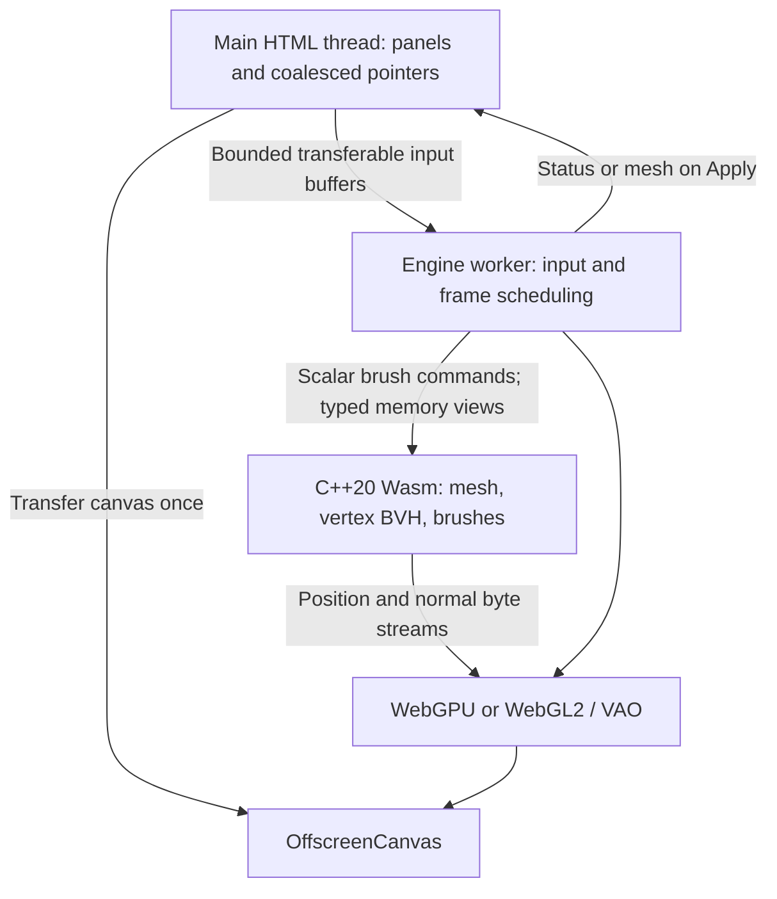

# V2 architecture and optimization notes



## Ownership and synchronization

The editor copies the selected geometry only when opening the performance workspace. Its existing geometry is retained for Discard and failure recovery. Positions/indices transfer to the worker once. The worker copies these into fixed Wasm linear memory at setup, creates long-lived typed views, builds the point BVH and allocates GPU buffers. C++ works directly on that memory. No mesh arrays cross the main/worker boundary for each dab.

The original viewport stops rendering while the performance workspace is open. DOM controls send settings; pointer callbacks pack eight float lanes per sample: normalized x/y, pressure, tiltX/tiltY, timestamp, event kind, orbit flag. `engine/client.js` is the full implementation, including pointer capture, coalesced events, cancellation, bounded backpressure and Apply ordering.

The worker processes a batch synchronously; then it recalculates normals and uploads the changed mesh. Its animation callback draws only when dirty. Input events can arrive between frame callbacks. Input batches are bounded at 128 samples; four buffers cap in-flight allocations/queued work. Overload drops samples rather than growing a queue forever. A stroke-end replaces the last pending sample if necessary. GPU resources are released by terminating the dedicated worker on exit. Context/device loss returns an error; reopening creates a fresh workspace.

`engine/sculpt.cpp` is the complete C++ implementation. Setup builds a median-split vertex BVH with leaves of at most 16 vertices. A dab rejects sphere/AABB misses, edits only candidate leaves, then refits changed ancestors. Neither mesh storage nor BVH nodes allocate during dabs. BVH building and initial GPU allocation happen before ready. Fixed memory includes a full previous-stroke position snapshot, CSR vertex-neighbor arrays for Smooth/Polish, and frozen Drag influence weights.

## Parallel deformation implementation

The `P3_THREADS` source path creates a persistent helper during setup. `dab` sends the left subtree to that helper and processes the right subtree in the calling engine worker. Each subtree owns distinct vertex indices and BVH nodes; shared normals are read-only during this step. A condition-variable barrier completes before root refitting, normal recomputation and upload. No thread is created per stroke. Small meshes use the serial path to avoid synchronization overhead. See `startPool` and `dab` in the delivered C++ for the actual working code.

This strategy balances by mesh halves rather than brush candidates; a localized brush may hit only one half. SIMD is compiler-enabled, not a promise that all irregular BVH work vectorizes. Browser profiling must determine whether the threaded option helps a particular mesh/device.

## Rebuild the bundled single-worker engine

With an activated Emscripten SDK:

```sh
./engine/build.sh
```

Relevant options:

| Option | Purpose / tradeoff |
| --- | --- |
| `-std=c++20 -O3 -flto` | C++20, optimized compilation and link-time optimization |
| `-msimd128` | Permit Wasm SIMD; requires SIMD support |
| `--no-entry -s STANDALONE_WASM=1` | Standalone module loaded inside the existing worker |
| `-s INITIAL_MEMORY=134217728` | Reserve 128 MiB linear memory; actual process/GPU use is higher |
| `-s ALLOW_MEMORY_GROWTH=0` | Keep typed views stable; fail capacity checks instead of growing |

The supplied binary was built with Zig's C++ compiler in WASI reactor mode, SIMD, fixed memory, no exceptions/RTTI, and no imported WASI functions. `engine/build-zig.sh` reproduces that route with `pip install ziglang`. Both build routes use the same C++ source and export ABI. The Emscripten scripts are provided but were not executed here.

## Optional pthread build

```sh
./engine/build-threaded.sh
```

This adds `-pthread -DP3_THREADS -s PTHREAD_POOL_SIZE=1`, modularized ES-module glue, and worker environment support. Keep the generated JS, Wasm and worker support files together in `engine/`. Open the hosted editor with `?p3threads=1`. The loader attempts that build only when `crossOriginIsolated` is true, and falls back to the bundled single-worker engine if loading fails.

A host must send:

```http
Cross-Origin-Opener-Policy: same-origin
Cross-Origin-Embedder-Policy: require-corp
```

Use correct JavaScript and `application/wasm` content types. `require-corp` also constrains third-party assets: retain CORS-compatible module fetches and audit all imported resources. `SharedArrayBuffer` is gated by isolation; being inside a Worker alone does not enable it. Web-views need capability tests just like browsers. GitHub Pages does not honor arbitrary `_headers` files; use the bundled single-worker path there, or move to hosting where response headers are configurable. Do not require pthreads to open the editor.

## Rendering and allocation constraints

WebGPU is attempted inside the worker, followed by WebGL2 when no suitable adapter/context is available. GPU position/normal/index buffers are persistent. WebGL2 uses a persistent VAO and `bufferSubData`; WebGPU uses `writeBuffer`. The material lookup texture is generated once and reused. The adaptive matcap variant removes the extra specular work from the lit-clay shader. It is a shader branch within one pipeline, not a complete PBR-to-matcap pipeline migration.

WebGPU mapped staging buffers are not direct views into Wasm linear memory. `MAP_WRITE` is limited to compatible usages (typically COPY_SRC staging), and mapped resources must be unmapped before GPU use. `writeBuffer` is the simpler portable streaming choice here. Do not describe either API as guaranteed zero-copy into VRAM.

Before production: measure input-to-visible latency and presented frames on actual iPads at 60/120 Hz; profile full normal recomputation and buffer uploads; use dirty spans/adjacency; test GPU loss, low-memory termination, large imports, reopened PWA caches and rapid pointer cancellation. Native tests are correctness checks, not device benchmarks.

## Primary references

- WebGPU specification: https://www.w3.org/TR/webgpu/
- Emscripten pthreads and isolation: https://emscripten.org/docs/porting/pthreads.html

## V2.0.4 brush additions

The main editor and worker both expose eleven brushes. Grab retains its earlier incremental behavior; Drag uses separate frozen weights and a view-plane displacement. Crease combines tangential contraction with a normal cut, Scrape removes points above an offset plane, and Polish uses neighbor smoothing with most normal shrinkage removed. Smooth and Clay are also available in the worker. Smooth/Polish copy positions into a reusable Wasm scratch array before parallel candidate updates so neighbor reads do not race vertex writes.

The main editor uses bounded, coalesced-input frame batches and skips full position snapshots for brushes without neighbor dependencies. Contact normals use normal matrices; raycasts refresh world matrices before intersecting. Main brush indicators are scene helpers; the worker uses a DOM overlay for the screen-space brush preview.
